<p align="center">
  
</p>

<h1 align="center">Clipped</h1>

<p align="center"><strong>Use Clipped. Cause Windows clipboard is clapped!</strong></p>

<p align="center">
  <sub>A clipboard manager for Windows that turns <kbd>Win</kbd> + <kbd>V</kbd> into your own
  snippet shelf — history, tabs, sequences, dates, emoji and GIFs, searchable, and stored on
  your machine.</sub>
</p>

<p align="center">
  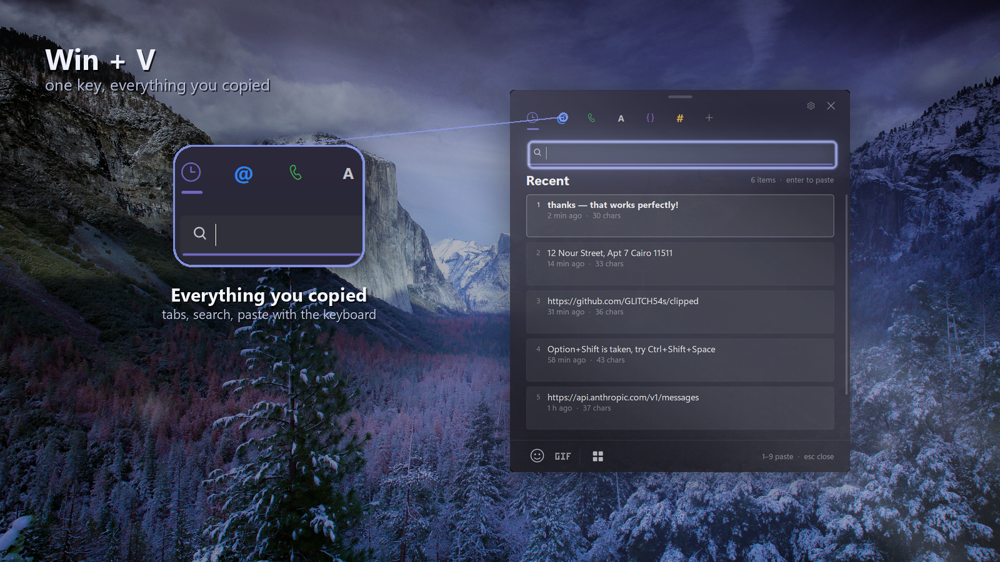
</p>

<p align="center">
  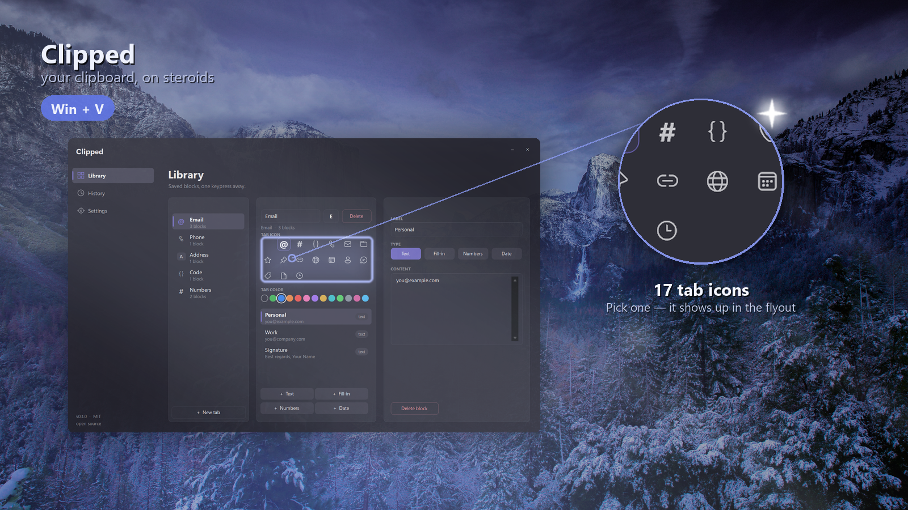
</p>

<p align="center">
  <a href="#getting-started"></a>
  <a href="#getting-started"></a>
  <a href="#project-layout"></a>
  <a href="#license"></a>
</p>

---

## Why Clipped

Windows' clipboard history is a list of what you copied, five minutes ago, in a column you
cannot search. Clipped turns that same key into a workspace:

- **History you can actually use** — everything you copied, text and screenshots, is captured and searchable, not just the last handful.
- **Your own library** — tabs full of reusable snippets: emails, addresses, SQL, ticket numbers, signatures.
- **Smart blocks** — text, `INC-{n}` templates that count up for you, number sequences, and today's date in any format.
- **Emoji and GIFs** — nearly 1,900 emoji in Windows colour or clean monochrome outline, plus GIF search.
- **It pastes for you** — pick an item and it lands in the window you came from.

<p align="center">
  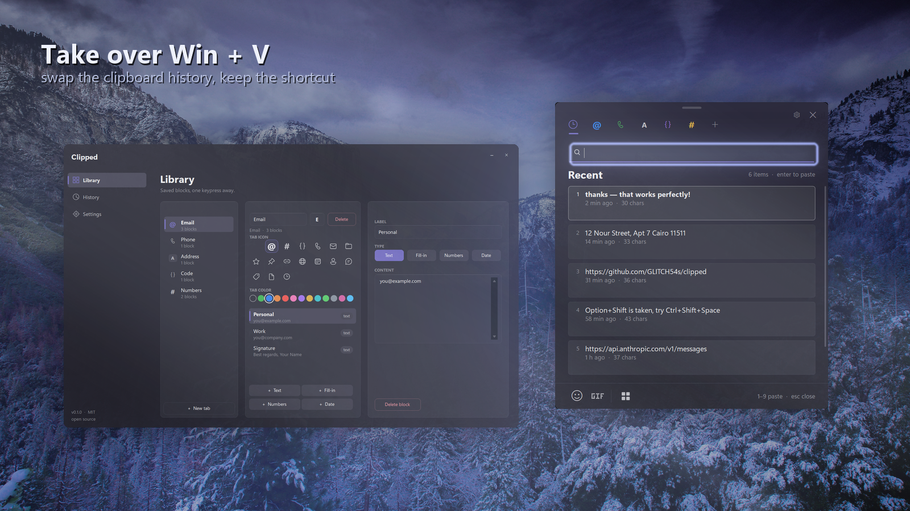
</p>

## Features

### 🗂️ Clipboard history
Every text copy is captured in the background and stored locally. Filter it with a keystroke,
re-pick it with <kbd>Enter</kbd>, delete single entries, or clear the lot. History size is
configurable (10–500 entries, 150 by default).

Screenshots — including <kbd>Win</kbd>+<kbd>Shift</kbd>+<kbd>S</kbd> and Snipping Tool copies —
land in the same list with a thumbnail, so you can paste one back without opening the tool again.
Image clips are pruned automatically (the newest 30, about 100 MB in total) so they cannot fill
the disk.

History stays in step with the Windows clipboard while Clipped runs, and whatever is on the
clipboard when it starts is captured too — so nothing you copied before launch goes missing.

### 🗄️ One dashboard
Everything lives in a single window with three pages — **Library** (your tabs and blocks),
**History** (everything you copied, searchable) and **Settings** (hotkey, appearance, startup,
GIF key). No configuration files to hunt for.

<p align="center">
  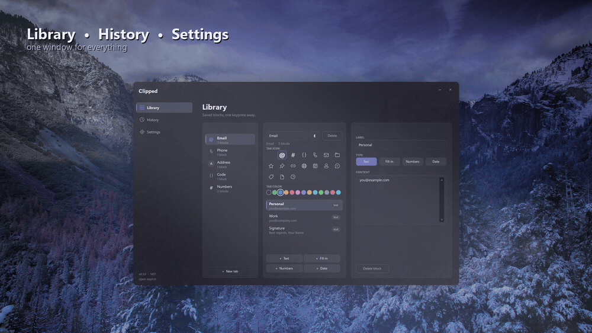
</p>

### 📚 Tabbed snippet library
Organise snippets into tabs — *Email*, *Phone*, *Address*, *Code*, *Numbers*. Each tab gets:

- **17 tab icons** and **12 accent colours** that carry through to the flyout.
- **A one-key mnemonic** (`Ctrl`+`1` … `Ctrl`+`9`) so you can jump straight to it.
- **Blocks** of four kinds:
  - **Text** — anything static, including multi-line snippets.
  - **Template** — `INC-{n}` style, with a counter you set the start and step of.
  - **Sequence** — `1 → 20`, with a step size; pick a single value or paste the whole run.
  - **Date** — today's date in any .NET date format (`dddd, dd MMM yyyy`, `yyyy-MM-dd`, …).

<p align="center">
  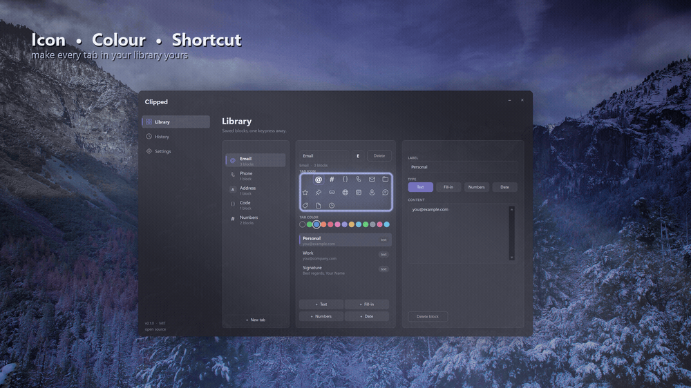
</p>

### ⌨️ Keyboard first
The picker is built for the keyboard: type to filter, <kbd>↑</kbd>/<kbd>↓</kbd> to move,
<kbd>Enter</kbd> to paste, <kbd>Esc</kbd> to dismiss, <kbd>Ctrl</kbd>+<kbd>Tab</kbd> to cycle
tabs. Nothing needs the mouse.

### 😀 Emoji
Nearly 1,900 emoji across 8 categories, generated from the Unicode emoji test file. Two styles:
Windows colour emoji or a monochrome outline set. Recent emoji are remembered.

### 🎞️ GIF search
Built on the [KLIPY](https://klipy.com) API (the Tenor-compatible successor Google retired).
Add a free API key in **Settings → GIF**, or set `CLIPPED_GIF_API_KEY` in the environment.
Pick a GIF and it is staged on disk, placed on the clipboard as a file drop, and pasted into
the target window.

### 🎨 Themes that follow Windows
**System**, **Light** or **Dark**. The accent colour is read from Windows, so Clipped looks
like it belongs on your desktop — and it repaints the instant your system theme changes.

<p align="center">
  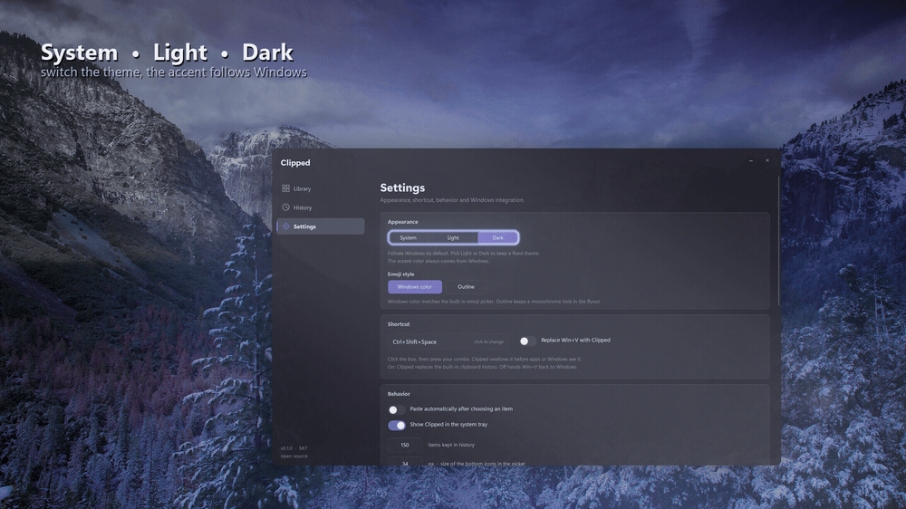
</p>

### 🪟 Windows integration
- Appears in **Settings → Apps** with a working uninstaller — or hands that job to the
  installer when one owns the install, so the two never fight over the entry.
- Optional **launch at sign-in** and a **Start-menu shortcut**.
- Registers the `clipped://` protocol so links can open the picker, the dashboard or a tab.
- Ships a **Widgets Board card** (`Widget/`) that puts your recent clips on the Windows 11
  widget board as a small, medium or large tile.
- Installed as an **MSIX package**, the manifest provides the protocol, the startup task and
  the uninstall entry instead — the app writes no registry keys of its own.

### 🔒 Local by default
There is no account, no cloud and no telemetry. Your library and history live in a single
JSON file on your machine; image clips are kept as PNG files in its `images` folder.

<p align="center">
  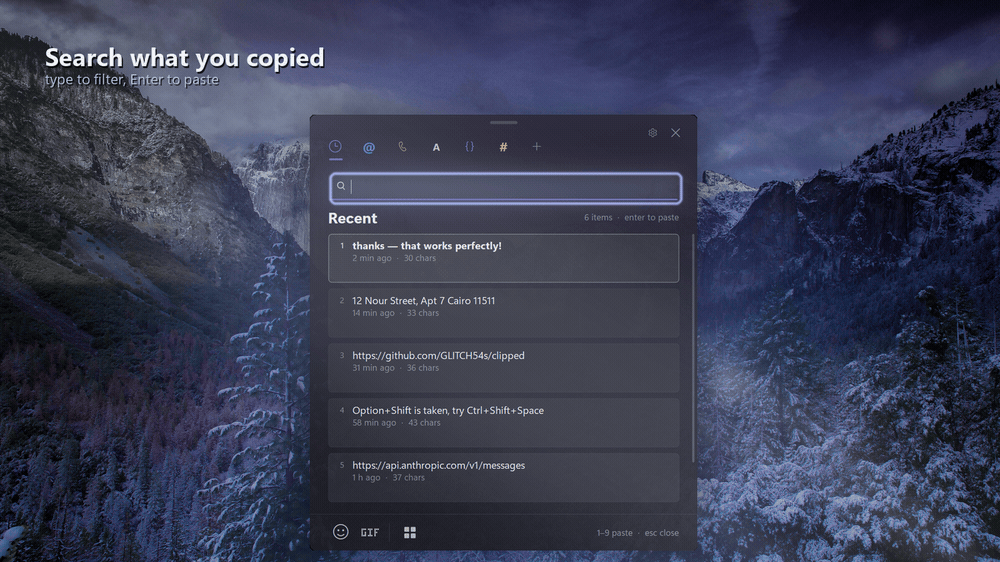
</p>

## Screenshots

| | |
|---|---|
| 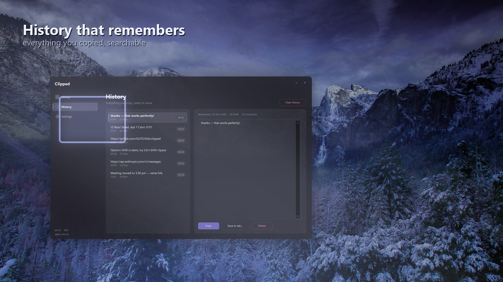 | 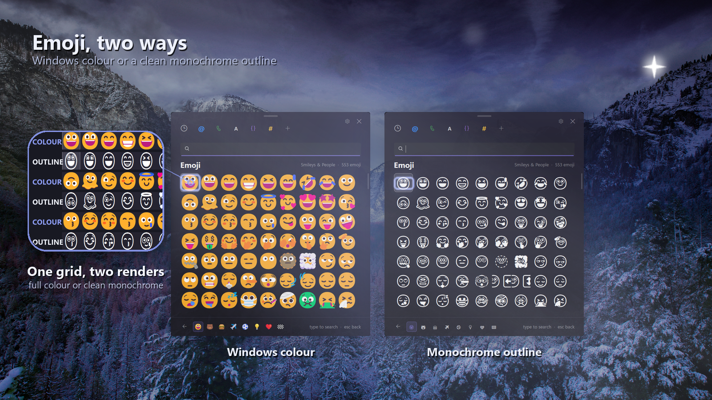 |
| 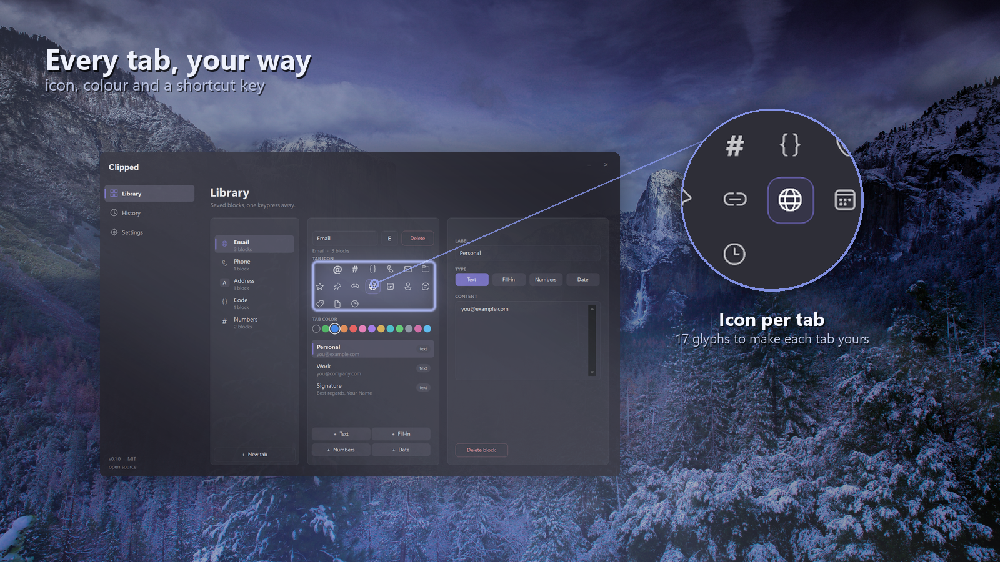 | 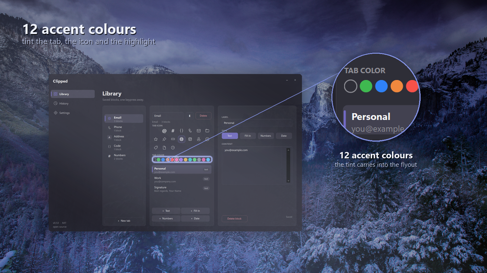 |

<p align="center">
  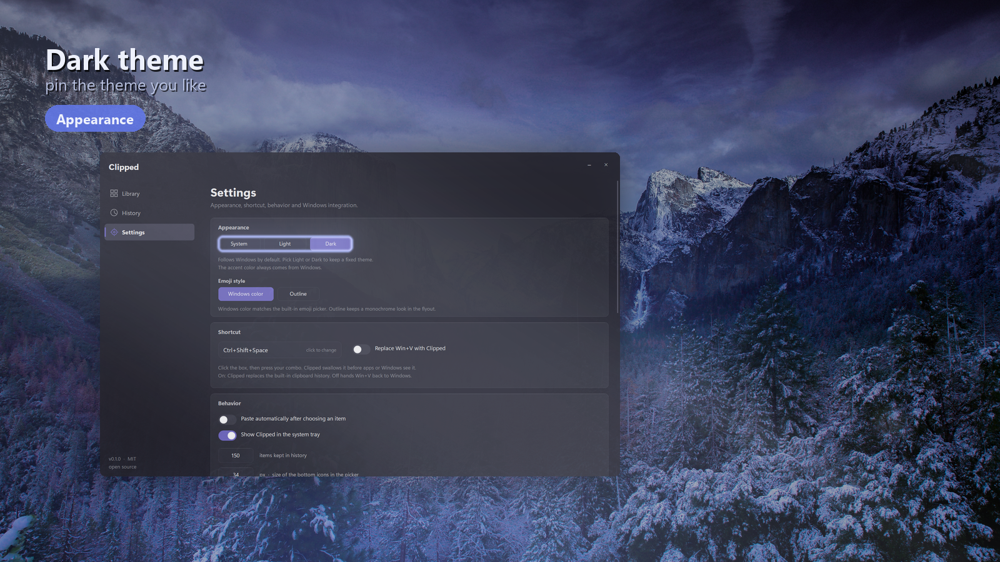
  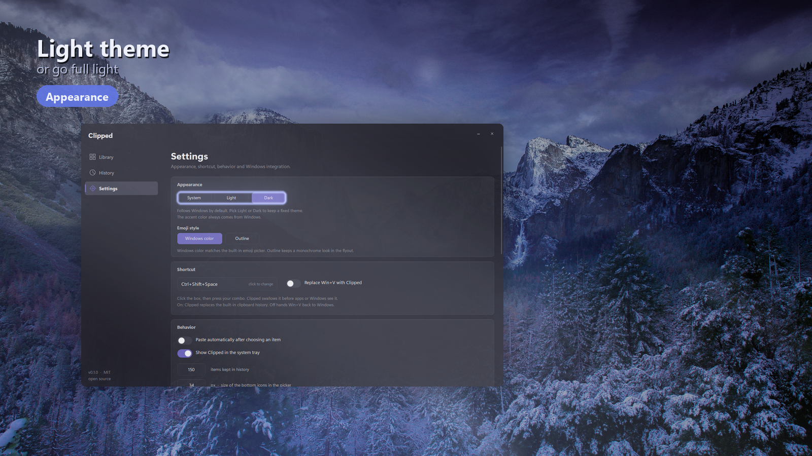
  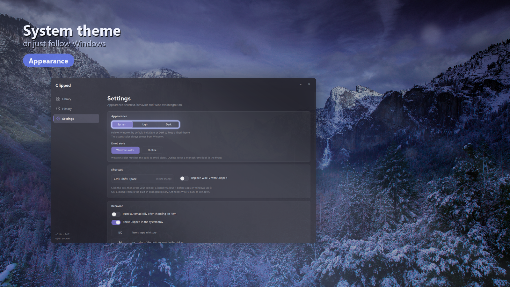
</p>

## Getting started

### Requirements

- Windows 10 or newer (Windows 11 for the Widgets Board card)
- The [.NET 9 SDK](https://dotnet.microsoft.com/download/dotnet/9.0) to build — or the
  .NET 9 Desktop Runtime to run a framework-dependent build

### Windows installer

```bash
bash installer/build.sh
```

One command: it publishes a self-contained win-x64 build, compiles the Inno Setup script and
writes both artifacts into `%CLIPPED_BUILD_DIR%\dist` (defaults to a `build/clipped-installer/dist`
folder beside the repo).

- **`Clipped-Setup-0.1.0.exe`** — per-user install into `%LOCALAPPDATA%\Programs\Clipped`, no
  UAC needed. Adds a single Start-menu entry for the picker, an optional
  "launch at sign-in" task and a real uninstaller under **Settings → Apps**. The build is not
  code-signed, so SmartScreen warns on first run.
- **`Clipped-0.1.0-portable.zip`** — unzip and run `Clipped.exe`. Nothing is installed.

### MSIX package

```powershell
powershell -File installer/msix/build-msix.ps1 -Register
```

Builds a `.msix` that packs the dashboard **and** the Widgets Board provider into one
package, then sideloads it — Windows needs Developer Mode on for that. Add `-PfxPath` and
`-PfxPassword` to sign the package with your own certificate.

Because a packaged build gets its protocol handler, startup task and uninstall entry from
the manifest, the app itself writes no registry keys.

### From source

```bash
git clone https://github.com/GLITCH54s/Clipped.git
cd Clipped
dotnet run --project Clipped.csproj
```

Or publish your own build:

```bash
# framework-dependent (needs the .NET 9 desktop runtime)
dotnet publish Clipped.csproj -c Release -r win-x64 --self-contained false -o publish

# self-contained, no runtime needed on the target machine
dotnet publish Clipped.csproj -c Release -r win-x64 --self-contained true -o publish-standalone
```

On first launch Clipped opens the dashboard and installs the `Win`+`V` hotkey. Everything is
configurable from **Settings** — the hotkey, startup, tray icon, theme, history size and emoji style.

### Widgets Board card (optional)

```powershell
powershell -File Widget/package.ps1 -Configuration Release -Register
```

Builds the packaged widget provider and registers `GLITCH54s.ClippedWidget` with the Windows
Widgets Board, where Clipped shows your recent clips as a small, medium or large card. It ships
separately from the classic installer because the board loads packaged COM providers — if you
installed the **MSIX package** above, the card is already bundled in it and you can skip this.

### Uninstall

- **Installed with the setup file:** Settings → Apps → Installed apps → Clipped → Uninstall.
  Your library and history stay in `%APPDATA%\Clipped` so nothing is lost.
- **Installed as an MSIX package:** Settings → Apps → Installed apps → Clipped → Uninstall.
- **Portable or manual install:** run `Clipped.exe --uninstall` to drop the Windows Settings
  entry, the Start-menu shortcut and the `clipped://` handler, then delete the folder.

## Keyboard shortcuts

| Shortcut | Action |
|---|---|
| `Win` + `V` | Open / close the Clipped picker (can be turned off) |
| Your own combo | Custom hotkey, set in Settings |
| `Ctrl` + `Tab` / `Ctrl` + `Shift` + `Tab` | Cycle through tabs |
| `Ctrl` + `0` … `Ctrl` + `9` | Jump to Recent / the first nine tabs |
| Type | Filter history and snippets |
| `↑` `↓` `PgUp` `PgDn` `Home` `End` | Move the selection |
| `Enter` | Paste the selected item into the previous window |
| `Backspace` (empty search) | Go back to the previous view |
| `Esc` | Close the picker |

## Configuration

Everything is stored in `%APPDATA%\Clipped\clipped.json` — a single readable JSON file you
can back up or hand-edit. A log lives next to it in `clipped.log`.

| Variable | Purpose |
|---|---|
| `CLIPPED_DATA_DIR` | Move the data folder somewhere else |
| `CLIPPED_GIF_API_KEY` | KLIPY API key for GIF search |

## Deep links and command line

| Argument | Effect |
|---|---|
| `--picker` | Open the picker |
| `--dashboard` | Open the dashboard on the library |
| `--settings` / `--modify` | Open the dashboard on settings |
| `--dates` | Open the picker on the date block |
| `--gif` | Open the picker on GIF search |
| `--uninstall` | Remove the Windows integration entries |
| `clipped://…` | Protocol handler, same targets as above |
| `clipped://dashboard/history` | Open the dashboard on the history page |

## Project layout

```
Clipped/
├── Clipped.csproj        # the app
├── Program.cs            # entry point, single-instance + deep links
├── AppController.cs      # hotkey, tray, clipboard watcher, paste plumbing
├── Core/                 # models, store, clipboard watcher, hotkey, pasting, GIF provider
├── UI/                   # picker, dashboard, theme, controls, emoji catalog
├── Widget/               # Widgets Board provider + its MSIX package
├── installer/            # Inno Setup script, build pipeline and the MSIX package
├── assets/               # app icon
└── docs/assets/          # images used by this README
```

## Contributing

Issues and pull requests are welcome. If you change the UI, re-capture the screenshots in
`docs/assets` from a real build and keep the file names the same so this README keeps working.

## License

MIT
